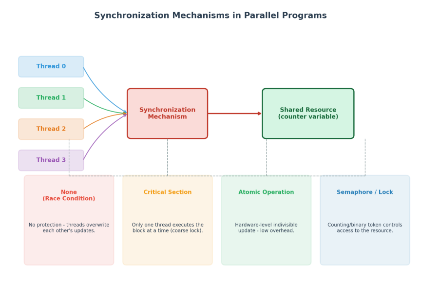
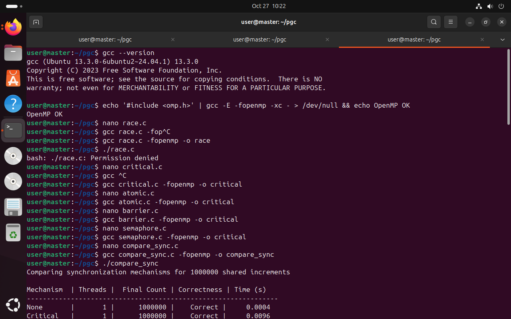
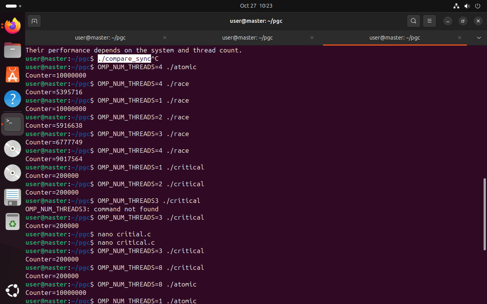
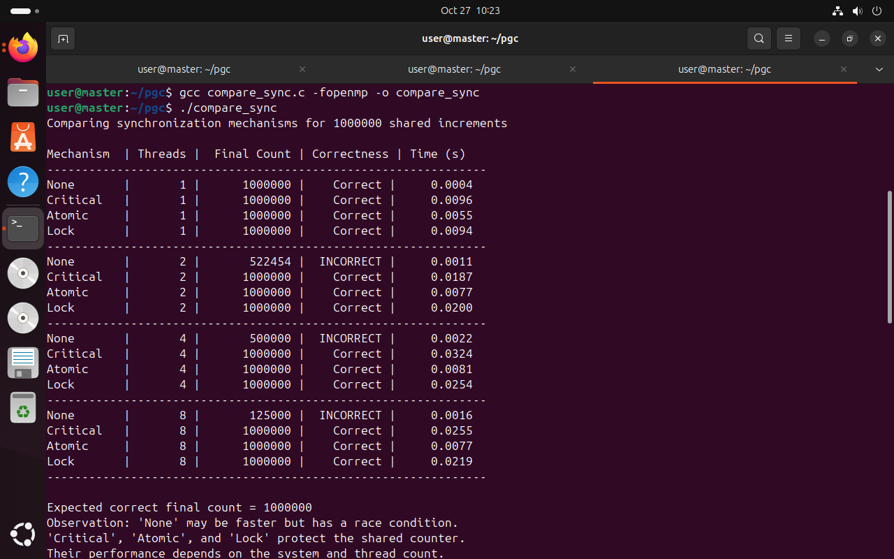
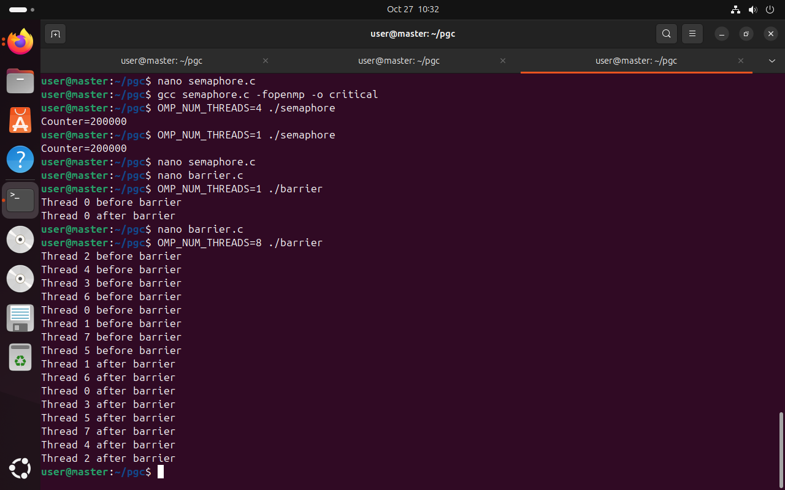
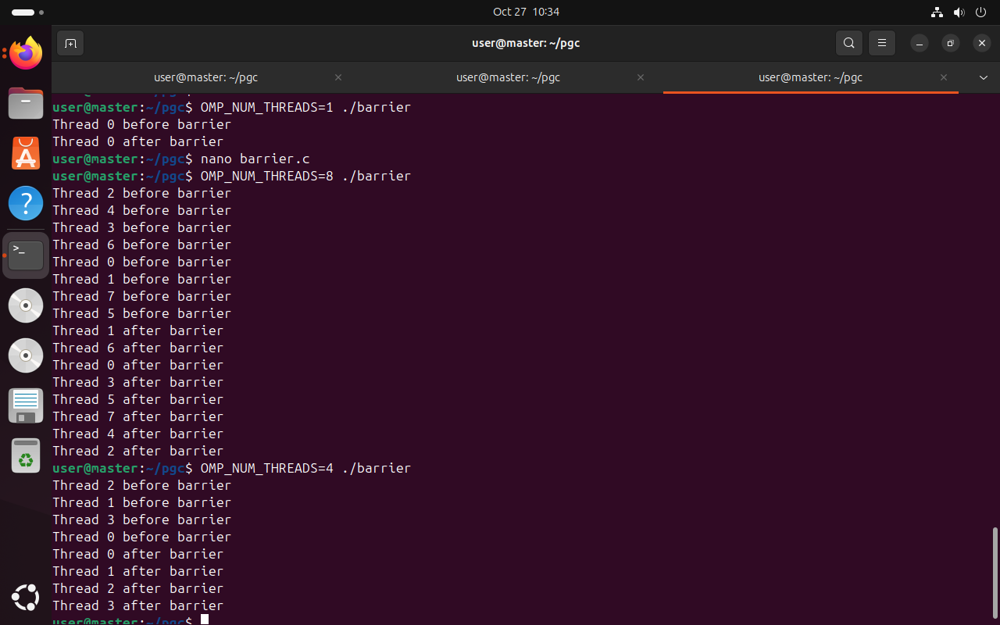

# Experiment 5 — Analysis of Synchronization Mechanisms in Parallel Programs


---

## Table of Contents
1. [Aim](#1-aim)
2. [Objectives](#2-objectives)
3. [Requirements](#3-requirements)
4. [Theory / Concepts](#4-theory--concepts)
5. [Diagram](#5-diagram)
6. [Procedure](#6-procedure)
7. [Programs](#7-programs)
8. [Observations (with screenshots)](#8-observations-with-screenshots)
9. [Result Analysis](#9-result-analysis)
10. [Problems Faced & Fixes](#10-problems-faced--fixes)
11. [Conclusion](#11-conclusion)
12. [Viva Questions](#12-viva-questions)
13. [Repository Structure](#13-repository-structure)
14. [How to Reuse This Repo / GitHub Steps (Quick Guide)](#14-how-to-reuse-this-repo--github-steps-quick-guide)

---

## 1. Aim
To implement and analyse common synchronization mechanisms used in shared-memory parallel programs — **race condition (no synchronization), critical section, atomic operation, barrier and semaphore/lock** — and to compare their **correctness, execution time and scalability** as the number of threads increases.

## 2. Objectives
After completing this experiment, the student will be able to:

1. Explain why synchronization is required when threads share data.
2. Demonstrate a **race condition** and observe lost updates.
3. Use OpenMP `critical`, `atomic` and `barrier` directives correctly.
4. Use a POSIX **semaphore** (and an OpenMP lock) to enforce mutual exclusion.
5. Measure execution time with `omp_get_wtime()` and compare mechanisms for 1, 2, 4 and 8 threads.
6. Judge a synchronization strategy on **correctness, performance and scalability**.

## 3. Requirements

### 3.1 Hardware
| Item | Specification |
|---|---|
| Processor | Multi-core CPU (≥ 4 cores allocated to the VM) |
| RAM | 2–4 GB allocated to the VM |
| Disk | ≥ 20 GB virtual disk |

### 3.2 Software
| S.No. | Software / Tool | Purpose |
|---|---|---|
| 1 | VMware Workstation Pro | Hosts the Ubuntu guest OS |
| 2 | Ubuntu Linux (24.04 LTS used in this run — see screenshot 1) | Guest OS for compiling and running programs |
| 3 | GCC (`build-essential`), version 13.3.0 | C compiler |
| 4 | OpenMP (`libgomp`, bundled with GCC) | `#pragma omp` parallel loop, critical, atomic, barrier, locks |
| 5 | POSIX Threads + `semaphore.h` | Semaphore program |
| 6 | Terminal + `nano` | Edit, compile, run, record timings |
| 7 | Git (for this repository) | Version control / submission |

> The original lab sheet specifies Ubuntu 22.04 LTS; the terminal output captured during this run shows GCC 13.3.0 from **Ubuntu 24.04**. Both work identically for this experiment.

### 3.3 Installation (one-time)
```bash
sudo apt update
sudo apt install build-essential git -y
gcc --version
echo '#include <omp.h>' | gcc -E -fopenmp -xc - > /dev/null && echo OpenMP OK
```

## 4. Theory / Concepts

### 4.1 Why synchronization is needed
In shared-memory programs several threads may read and write the same variable at the same time. A statement such as `counter++` is really **three steps** — *read → increment → write*. If two threads read the same old value before either writes back, one update is **lost**. Synchronization mechanisms control access to shared data so the result is correct regardless of thread scheduling.

### 4.2 Race condition
The outcome depends on the relative timing of threads accessing shared data without protection. It is the fastest option (no overhead) but gives **wrong and non-repeatable** results.

### 4.3 Critical section (`#pragma omp critical`)
A block that **only one thread can execute at a time**; others wait. Always correct, but all threads queue on one lock, so it becomes a **scalability bottleneck** as threads increase.

### 4.4 Atomic operation (`#pragma omp atomic`)
Performs a simple read-modify-write as a single **indivisible hardware instruction** (e.g., `lock add`, compare-and-swap) instead of a general lock. Correct and usually much faster than `critical`, but limited to simple updates such as `counter++`.

### 4.5 Barrier (`#pragma omp barrier`)
A **meeting point**: no thread continues until *all* threads have arrived. It protects phases of computation, not data. Cost = waiting for the slowest thread.

### 4.6 Semaphore (`sem_wait` / `sem_post`)
A counter-based OS synchronization object. `sem_wait()` decrements (blocks at 0); `sem_post()` increments. A **binary semaphore** (initial value 1) acts like a mutex; a **counting semaphore** can admit N threads at once. Moderate system-call overhead.

### 4.7 Lock (`omp_lock_t`)
An explicit mutual-exclusion lock (`omp_set_lock` / `omp_unset_lock`). Behaves like `critical` but gives the programmer manual control.

### 4.8 Correctness vs. performance vs. scalability
| Property | Question |
|---|---|
| Correctness | Does it always give the right answer? |
| Performance | How fast is it for a given thread count? |
| Scalability | Does it stay fast (or improve) as threads are added? |

## 5. Diagram



*Fig. 1 — Multiple threads accessing a shared resource through different synchronization mechanisms.*

## 6. Procedure
1. Open a terminal and verify GCC and OpenMP support (Screenshot 1).
2. Create each source file with `nano` (or clone this repo to get them).
3. Compile each program (`make` compiles all, or use the commands in Section 7).
4. Run each program with different thread counts using `OMP_NUM_THREADS=<n> ./program`.
5. Run the benchmark `compare_sync`, which tests 1, 2, 4 and 8 threads automatically.
6. Record the final counter values and execution times; compare them against the expected result.
7. Tabulate the observations and write the conclusion.

| Step | Command | Purpose |
|---|---|---|
| 1 | `sudo apt update && sudo apt install build-essential -y` | Install GCC + OpenMP |
| 2 | `nano race.c` (repeat per file) | Create source files |
| 3 | `gcc race.c -fopenmp -o race` | Compile race program |
| 4 | `gcc critical.c -fopenmp -o critical` | Compile critical program |
| 5 | `gcc atomic.c -fopenmp -o atomic` | Compile atomic program |
| 6 | `gcc barrier.c -fopenmp -o barrier` | Compile barrier program |
| 7 | `gcc semaphore.c -pthread -o semaphore` | Compile semaphore program |
| 8 | `gcc compare_sync.c -fopenmp -o compare_sync` | Compile benchmark |
| 9 | `OMP_NUM_THREADS=4 ./atomic` | Run with chosen threads |
| 10 | `./compare_sync` | Full comparison for 1/2/4/8 threads |

## 7. Programs
All source files are in [`src/`](src/). Build everything with `make`.

| # | Program | Source | Compile command |
|---|---|---|---|
| 1 | Race condition | [`src/race.c`](src/race.c) | `gcc race.c -fopenmp -o race` |
| 2 | Critical section | [`src/critical.c`](src/critical.c) | `gcc critical.c -fopenmp -o critical` |
| 3 | Atomic operation | [`src/atomic.c`](src/atomic.c) | `gcc atomic.c -fopenmp -o atomic` |
| 4 | Barrier | [`src/barrier.c`](src/barrier.c) | `gcc barrier.c -fopenmp -o barrier` |
| 5 | Semaphore | [`src/semaphore.c`](src/semaphore.c) | `gcc semaphore.c -pthread -o semaphore` |
| 6 | Comparison benchmark | [`src/compare_sync.c`](src/compare_sync.c) | `gcc compare_sync.c -fopenmp -o compare_sync` |

**Key lines from each program:**

```c
/* 1. Race:     */ counter++;                                   // unprotected
/* 2. Critical: */ #pragma omp critical { counter++; }          // one thread at a time
/* 3. Atomic:   */ #pragma omp atomic   counter++;              // hardware-level
/* 4. Barrier:  */ #pragma omp barrier                          // all threads wait here
/* 5. Semaphore:*/ sem_wait(&s); counter++; sem_post(&s);       // binary semaphore
/* 6. Lock:     */ omp_set_lock(&l); counter++; omp_unset_lock(&l);
```

## 8. Observations (with screenshots)

### 8.1 Environment verification and compilation
GCC 13.3.0 is installed and OpenMP is detected (`OpenMP OK`). All programs are then created with `nano` and compiled.



*Screenshot 1 — `gcc --version`, OpenMP check, and compilation of all programs.*

### 8.2 Race condition vs. critical vs. atomic (10,000,000 increments)
Expected final value = **10,000,000**.


*Screenshot 2 — `race`, `critical` and `atomic` for different thread counts.*

| Program | Threads | Final Counter | Correct? |
|---|---|---|---|
| race | 1 | 10000000 | ✅ Yes |
| race | 2 | 7286570 | ❌ No |
| race | 4 | 3730512 | ❌ No |
| race | 8 | 3535646 | ❌ No |
| critical | 1 / 2 / 4 | 10000000 | ✅ Yes |
| atomic | 4 | 10000000 | ✅ Yes |

### 8.3 Race condition is non-repeatable
The same program with the same thread count gives **different wrong answers each time**.



*Screenshot 3 — repeated runs of `race` (note the different values for 4 threads) and `critical` / `atomic` runs.*

| Run | Threads | Counter (race) |
|---|---|---|
| a | 4 | 5395716 |
| b | 1 | 10000000 |
| c | 2 | 5916638 |
| d | 3 | 6777749 |
| e | 4 | 9017564 |

Four-thread runs of `race` produced **3730512** (Screenshot 2), **5395716** and **9017564** — three different wrong answers for the same input, proof that a race condition is unpredictable.

### 8.4 Benchmark — `compare_sync` (1,000,000 increments)



*Screenshot 4 — output of `./compare_sync` for 1, 2, 4 and 8 threads.*

| Mechanism | Threads | Final Count | Correctness | Time (s) |
|---|---|---|---|---|
| None | 1 | 1000000 | Correct | 0.0004 |
| Critical | 1 | 1000000 | Correct | 0.0096 |
| Atomic | 1 | 1000000 | Correct | 0.0055 |
| Lock | 1 | 1000000 | Correct | 0.0094 |
| None | 2 | 522454 | **INCORRECT** | 0.0011 |
| Critical | 2 | 1000000 | Correct | 0.0187 |
| Atomic | 2 | 1000000 | Correct | 0.0077 |
| Lock | 2 | 1000000 | Correct | 0.0200 |
| None | 4 | 500000 | **INCORRECT** | 0.0022 |
| Critical | 4 | 1000000 | Correct | 0.0324 |
| Atomic | 4 | 1000000 | Correct | 0.0081 |
| Lock | 4 | 1000000 | Correct | 0.0254 |
| None | 8 | 125000 | **INCORRECT** | 0.0016 |
| Critical | 8 | 1000000 | Correct | 0.0255 |
| Atomic | 8 | 1000000 | Correct | 0.0077 |
| Lock | 8 | 1000000 | Correct | 0.0219 |

Raw text copy: [`results/compare_sync_output.txt`](results/compare_sync_output.txt)

### 8.5 Semaphore
Two pthreads each add 100,000 → expected **200,000**.



*Screenshot 5 — `semaphore` output (`Counter=200000`) followed by `barrier` with 1 and 8 threads.*

| Program | Final Counter | Correct? |
|---|---|---|
| semaphore (run 1) | 200000 | ✅ Yes |
| semaphore (run 2) | 200000 | ✅ Yes |

> `OMP_NUM_THREADS` has **no effect** on this program: it creates exactly two pthreads itself, so the result and thread count are the same for any setting.

### 8.6 Barrier
With a barrier, **every** "before barrier" line appears before **any** "after barrier" line, though the order *within* each group varies.



*Screenshot 6 — `barrier` with 1, 8 and 4 threads.*

| Threads | All "before" printed before any "after"? |
|---|---|
| 1 | ✅ Yes |
| 4 | ✅ Yes |
| 8 | ✅ Yes |

## 9. Result Analysis

| Mechanism | Correctness | Relative performance (measured) | Scalability |
|---|---|---|---|
| None (race) | ❌ Incorrect for ≥ 2 threads | Fastest (0.0004–0.0022 s) | Poor — error grows with threads (522454 → 500000 → 125000) |
| Critical | ✅ Correct | Slowest at 4 threads (0.0324 s) | Poor — time rose from 0.0096 s (1 thread) to 0.0324 s (4 threads) |
| Atomic | ✅ Correct | Fast (0.0055–0.0081 s) | Good — almost flat across 1–8 threads |
| Lock (`omp_lock_t`) | ✅ Correct | Slow, similar to critical (0.0094–0.0254 s) | Poor to moderate |
| Barrier | Synchronizes phases | Waiting overhead | Moderate — limited by slowest thread |
| Semaphore | ✅ Correct | Moderate (system-call overhead) | Moderate |

**Key points**
- **Race condition:** correct only with 1 thread; every additional thread loses more updates.
- **Atomic is ~3–4× faster than critical/lock** at 4 and 8 threads (≈ 0.008 s vs 0.022–0.032 s).
- **Critical vs. lock:** both serialize threads, so their times are close; they rise with thread count because threads spend more time waiting than working.
- **None is the fastest only because it is wrong** — speed without correctness is useless.
- Timings vary from run to run and by VM/core count; the *trend* matters, not the exact values.

## 10. Problems Faced & Fixes
Issues that occurred while running this experiment (visible in Screenshot 1 and 3):

| Problem | Cause | Fix |
|---|---|---|
| `bash: ./race.c: Permission denied` | Tried to run the **source file** instead of the executable | Run `./race` (the compiled binary) |
| `OMP_NUM_THREADS3: command not found` | Missing `=` sign | Use `OMP_NUM_THREADS=3 ./critical` |
| `./critical` printed `Counter=200000` instead of `10000000` | Several programs (`atomic`, `barrier`, `semaphore`) were compiled with `-o critical`, **overwriting the critical binary** with the semaphore program | Give every program its own output name (`-o atomic`, `-o barrier`, `-o semaphore`); the `Makefile` does this automatically |
| Semaphore compiled with `-fopenmp` | Wrong flag for a pthread program | Use `gcc semaphore.c -pthread -o semaphore` |
| `compare_sync` ran with 1,000,000 instead of 10,000,000 increments | `N` was reduced to 1,000,000 for a quicker run | Final source keeps `N = 1000000L`; change to `10000000L` for longer runs |

## 11. Conclusion
- Unsynchronized access to a shared variable causes a **race condition**: it is the fastest option but gives wrong, unrepeatable results (e.g., 3,730,512 and 9,017,564 instead of 10,000,000 for 4 threads).
- **Critical sections and locks** guarantee correctness but serialize threads, so their execution time grows with thread count.
- **Atomic operations** gave the best balance of correctness and speed for a simple counter update, using hardware-level instructions and scaling far better than critical/lock.
- **Barriers** do not protect data; they ensure all threads finish one phase before any starts the next.
- **Semaphores** generalize mutual exclusion (binary or counting) at moderate OS-level overhead and produced the correct result (200,000).
- Choosing a mechanism is a trade-off between **strength of guarantee, overhead and scalability**.

## 12. Viva Questions
1. What is a race condition? Why does `counter++` fail without protection?
2. Difference between `critical` and `atomic`?
3. Why does `critical` scale poorly with more threads?
4. When can `atomic` **not** be used?
5. What does a barrier guarantee? Does it protect shared data?
6. Binary vs. counting semaphore? How does a semaphore differ from a mutex?
7. Why is the "None" version fastest in the benchmark, and why is that misleading?
8. Why did the race program give different answers on each run?
9. What does `OMP_NUM_THREADS` do, and why did it not affect the semaphore program?
10. Which mechanism would you choose for a simple shared counter, and why?

## 13. Repository Structure
```
sync-lab/
├── README.md                  <- this lab record
├── Makefile                   <- build / run / clean
├── .gitignore
├── src/
│   ├── race.c
│   ├── critical.c
│   ├── atomic.c
│   ├── barrier.c
│   ├── semaphore.c
│   └── compare_sync.c
├── results/
│   └── compare_sync_output.txt
└── docs/images/
    ├── fig1_sync_diagram.png
    └── ss1 … ss6 (terminal screenshots)
```

**Run everything:**
```bash
make          # compile all programs into bin/
make run      # run all with 4 threads + benchmark
make clean    # remove binaries
```

---

## 14. How to Reuse This Repo / GitHub Steps (Quick Guide)

### A. First time only — set up Git
```bash
sudo apt install git -y
git config --global user.name  "Your Name"
git config --global user.email "you@example.com"
```

### B. Publish this lab to GitHub
1. On github.com click **New repository** → name it (e.g. `pgc-lab-exp5-sync`) → **Create** (leave README unchecked).
2. In the project folder run:
```bash
git init
git add .
git commit -m "Experiment 5: synchronization mechanisms"
git branch -M main
git remote add origin https://github.com/<your-username>/pgc-lab-exp5-sync.git
git push -u origin main
```
3. GitHub asks for a **Personal Access Token** instead of a password: *Settings → Developer settings → Personal access tokens → Generate*, then paste it as the password.

### C. Reuse as a template for the next experiment
```bash
cp -r sync-lab pgc-lab-exp6-<topic>   # copy the folder
cd pgc-lab-exp6-<topic>
rm -rf .git bin                        # remove old history & binaries
rm docs/images/*.png results/*         # remove old screenshots/results
```
Then:
1. Replace the files in `src/` with the new programs and update the `Makefile` names.
2. Take new terminal screenshots → save in `docs/images/`.
3. Edit `README.md`: change the title, Aim, Objectives, Theory, Observations, Conclusion (keep the same 14-section layout).
4. Repeat **Step B** with a new repository name.

*(Or use GitHub's own method: open this repo → **Settings → check "Template repository"**; for each new experiment click **Use this template → Create a new repository**.)*

### D. Daily workflow (update an existing repo)
```bash
git status                     # see what changed
git add .                      # stage changes
git commit -m "Add screenshots"
git push                       # upload
git pull                       # download latest (e.g., on another PC)
git clone <repo-url>           # first-time copy of any repo
```

### E. Quick fixes
| Problem | Fix |
|---|---|
| `fatal: remote origin already exists` | `git remote set-url origin <url>` |
| Push rejected | `git pull --rebase origin main` then `git push` |
| Images not showing on GitHub | Use relative paths like `docs/images/x.png` and commit the PNGs |

---
*Prepared for the Parallel & Grid Computing laboratory — Experiment 5.*
